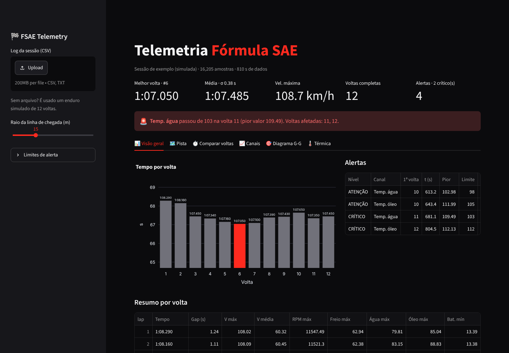
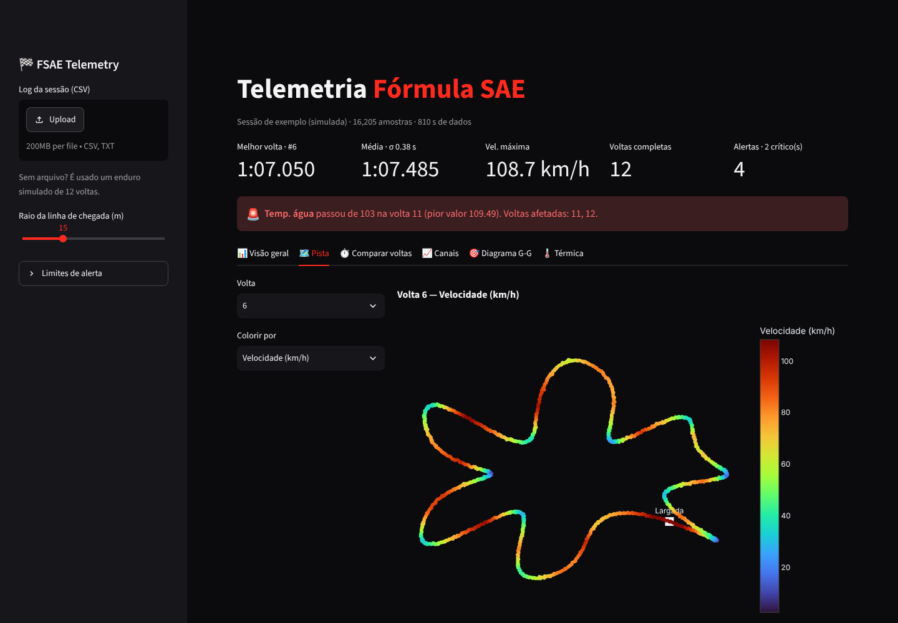
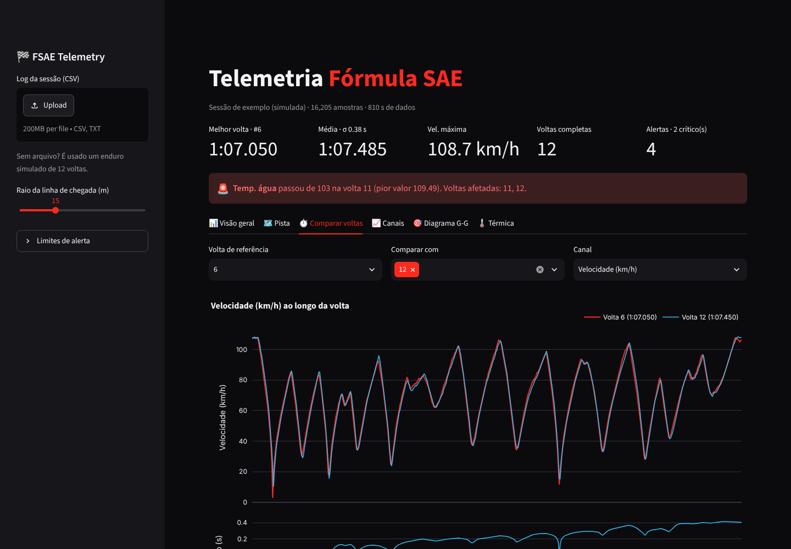
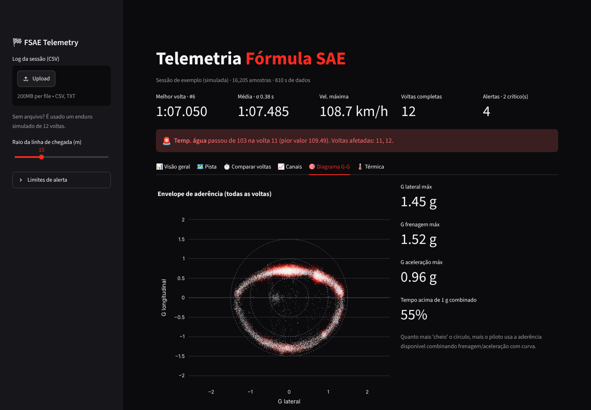
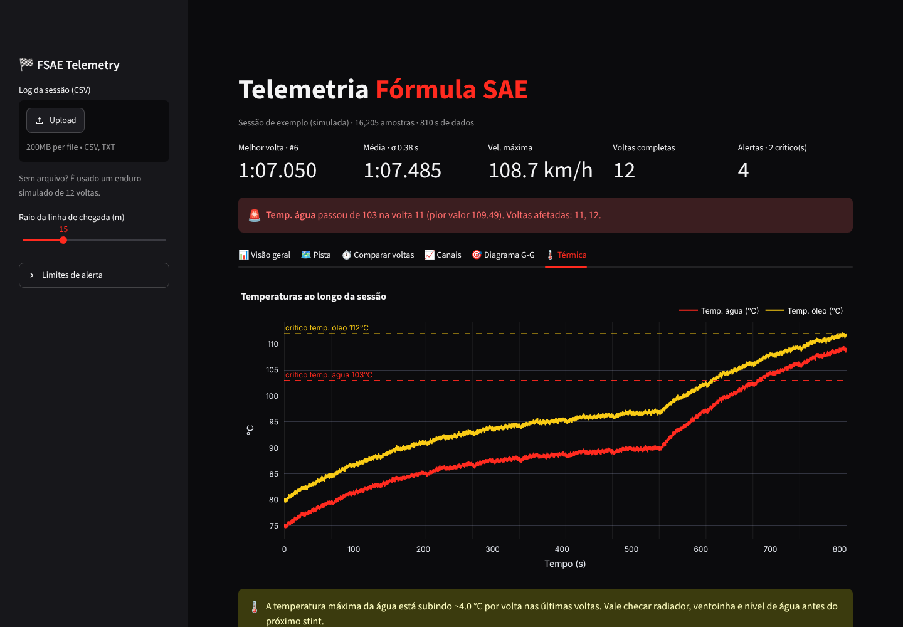

<h1 align="center">🏁 FSAE Telemetry</h1>

<p align="center">
  Dashboard de telemetria para carros de <b>Fórmula SAE</b>: detecção automática de voltas,
  comparação volta a volta com delta de tempo, mapa da pista, diagrama G-G e alertas térmicos.
</p>

<p align="center">
  
  
  
  
  
</p>

<p align="center">
  <a href="https://fsae-telemetry.streamlit.app"></a>
  &nbsp;<b>← teste o dashboard online, sem instalar nada</b>
</p>



## Por que esse projeto

Quatro anos em equipe de Fórmula SAE me ensinaram que o carro "fala" pelos dados: um
piloto perdendo tempo numa curva específica, uma água esquentando volta após volta antes
de virar problema na pista. Esse dashboard junta o que a equipe olha depois de cada
stint numa tela só, a partir de um CSV exportado do datalogger.

## O que ele faz

| | |
|---|---|
| **Detecção de voltas** | Encontra as passagens pela linha de chegada a partir do GPS (com histerese contra ruído) e calcula tempo, gap para a melhor volta e estatísticas por volta. |
| **Comparar voltas** | Sobrepõe qualquer canal em função da distância e mostra o **delta de tempo acumulado** — onde exatamente a volta ganha ou perde tempo. |
| **Mapa da pista** | Traçado colorido por velocidade, RPM, freio, acelerador etc. |
| **Diagrama G-G** | Envelope de aderência do carro (G lateral × longitudinal) e quanto da sessão o piloto passa acima de 1 g combinado. |
| **Alertas** | Limites configuráveis de temperatura de água/óleo, RPM e bateria, com primeira volta, pior valor e voltas afetadas. Também avisa tendência de aquecimento por volta. |
| **Leitura flexível** | Reconhece nomes comuns de dataloggers (`RPM`, `TPS`, `ECT`, `Vehicle Speed`…) e separador `,` ou `;`. |

<table>
<tr>
<td></td>
<td></td>
</tr>
<tr>
<td></td>
<td></td>
</tr>
</table>

## Rodando

```bash
git clone https://github.com/SaMoCaSa00/fsae-telemetry.git
cd fsae-telemetry
python -m venv .venv && source .venv/bin/activate   # Windows: .venv\Scripts\activate
pip install -r requirements.txt
streamlit run app.py
```

Sem arquivo carregado, o app abre uma sessão de enduro **simulada** de 12 voltas (veja abaixo).
Para usar um log real, é só arrastar o CSV na barra lateral.

## Dados simulados

`telemetry/simulate.py` gera um log realista para desenvolver e demonstrar sem depender de
dados da equipe:

- pista fechada (~1,1 km) gerada por spline periódica, largada na maior reta;
- perfil de velocidade *quasi-steady-state* com **círculo de atrito** — aderência lateral
  limita a velocidade de curva e reduz a aceleração/frenagem disponível;
- canais derivados: marcha e RPM pela relação de transmissão, acelerador e freio com
  atraso de 1ª ordem, forças g, temperaturas de água/óleo por balanço térmico simples e
  tensão de bateria;
- variação do piloto ao longo da volta, degradação de pneu e uma **falha de arrefecimento
  simulada a partir da volta 9** para exercitar os alertas.

```bash
python -m telemetry.simulate --laps 15 --hz 50 -o data/meu_log.csv
```

## Formato do CSV

| coluna | unidade | obrigatória |
|---|---|---|
| `time_s` | s | ✅ |
| `speed_kmh` | km/h | ✅ |
| `pos_x_m`, `pos_y_m` | m (coordenadas locais) | para voltas e mapa |
| `rpm`, `gear`, `throttle_pct`, `brake_bar` | — | |
| `g_long`, `g_lat` | g | para o G-G |
| `coolant_c`, `oil_c`, `battery_v` | °C, °C, V | para alertas |

## Estrutura

```
├── app.py                  # dashboard Streamlit
├── telemetry/
│   ├── analysis.py         # leitura, voltas, delta de tempo, alertas
│   └── simulate.py         # gerador de dados sintéticos
├── data/sample_endurance.csv
└── tests/                  # pytest
```

```bash
pip install -r requirements-dev.txt
pytest
```

## Próximos passos

- [ ] Conversão de latitude/longitude para coordenadas locais
- [ ] Detecção de setores e "volta ideal" (soma dos melhores setores)
- [ ] Importadores para formatos específicos de ECU/datalogger
- [x] Deploy no Streamlit Community Cloud

---

Feito por **Samuell Moura** — Eng. de Computação (UFU), ex-Fórmula Cefast.
[LinkedIn](https://www.linkedin.com/in/samuell-carreiro)
